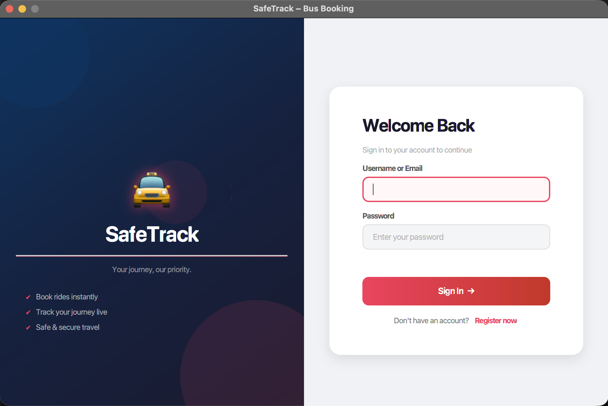
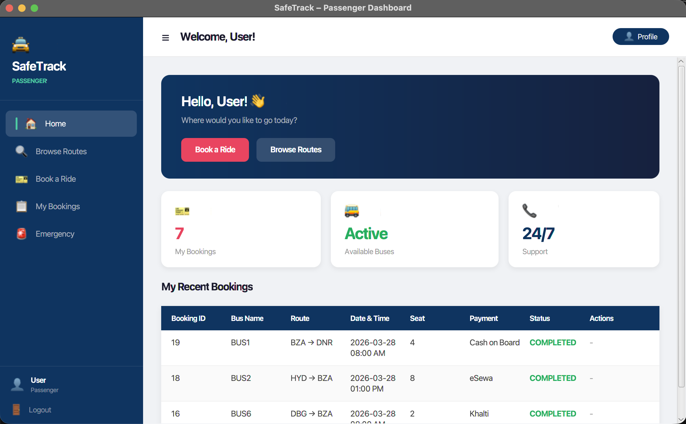
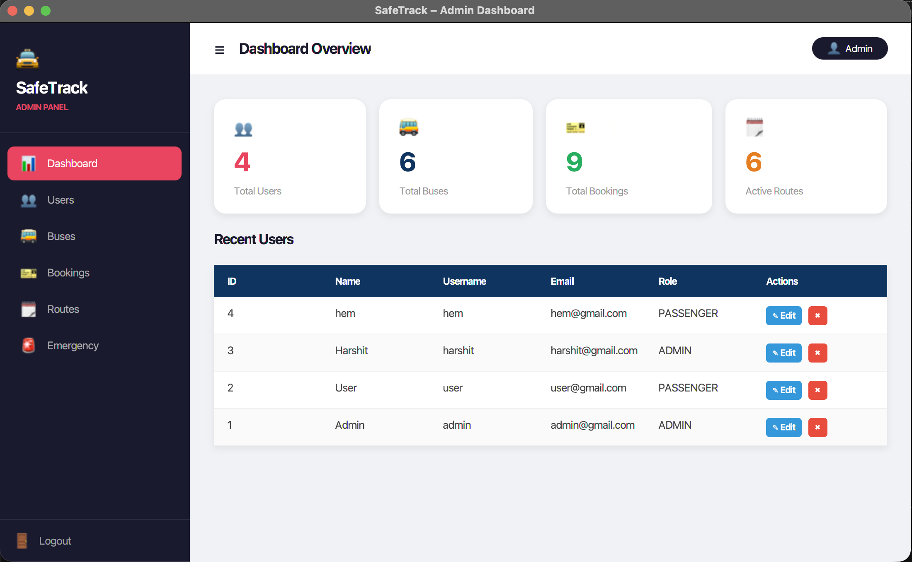

# SafeTrack — Bus Booking System

SafeTrack is a JavaFX desktop application for managing bus routes, buses, passengers, seat bookings, payments, and emergency contacts. It provides separate interfaces for passengers and administrators and stores application data in MySQL through JDBC.

## Features

### Passenger

- Register and sign in using a username or email
- Browse available routes and buses
- Select a journey date, departure time, and seat
- Choose a payment method when booking
- View, edit, and cancel personal bookings
- View and update profile information
- Access emergency contact information

### Administrator

- View totals for users, buses, bookings, and routes
- View, edit, and remove users
- Add, edit, and remove buses
- Add, edit, and remove routes
- View bookings and mark rides as completed
- Add, edit, and remove emergency contacts
- View and update the administrator profile

> [!NOTE]
> Payment selections are stored with the booking, but this project does not connect to a real card, UPI, or banking payment gateway.

## Visual Tour

### Login and registration entry point



### Passenger dashboard



### Administrator dashboard



The screenshots above use repository-relative paths. They will render on GitHub as long as the `images` directory is committed together with this README.

## Technology

| Area | Technology |
|---|---|
| Language | Java |
| Desktop UI | JavaFX 21.0.1 |
| Database | MySQL |
| Database access | JDBC with MySQL Connector/J 8.3.0 |
| Architecture | Model, View, Controller, Service, DAO, and Utility layers |
| macOS launcher | Bash (`run.sh`) |
| Windows launcher | Batch (`run.bat`) |

An IDE is optional. The project can be compiled and launched with the supplied scripts.

## Project Structure

```text
SafeTrack-Project/
├── src/com/safetrack/
│   ├── controller/      → Business logic and user actions
│   ├── dao/             → Database access and CRUD operations
│   ├── main/            → Application entry point
│   ├── model/           → User, bus, route, schedule, and ticket models
│   ├── service/         → Validation and service logic
│   ├── view/            → JavaFX screens and dashboards
│   └── util/            → Database connection and session utilities
├── images/              → Screenshots used in the README visual tour
├── resources/           → Application images and stylesheet
├── run.bat              → Windows build and launch script
└── README.md
```

`out/` is generated during compilation. The existing `safetrack.db` and SQLite driver are legacy artifacts; the current application connects to MySQL.

## Requirements

- JDK 21 or newer, including both `java` and `javac`
- MySQL Server running locally on port `3306`
- A MySQL user that can create and modify tables in the `safetrack` database
- Internet access on the first Windows launch so `run.bat` can download Windows JavaFX libraries

Verify Java with:

```bash
java -version
javac -version
```

## Database Setup

Sign in to MySQL:

```bash
mysql -u root -p
```

Create the database:

```sql
CREATE DATABASE IF NOT EXISTS safetrack;
EXIT;
```

Open `src/com/safetrack/util/DatabaseConnection.java` and set the connection details for your MySQL installation:

```java
private static final String URL =
        "jdbc:mysql://localhost:3306/safetrack?useSSL=false&serverTimezone=UTC";
private static final String USER = "root";
private static final String PASSWORD = "mysql123";
```

The application creates and seeds its tables when it starts, so there is no separate SQL schema file to import.

## Running on Apple Silicon macOS

The supplied `javafx_lib` directory contains JavaFX native libraries for Apple Silicon (`mac-aarch64`).

```bash
chmod +x run.sh
./run.sh
```

The script compiles the source into `out/` and starts `com.safetrack.main.Main`.

## Running on Windows x64

Run the supplied batch file from Command Prompt:

```bat
run.bat
```

Or from PowerShell:

```powershell
.\run.bat
```

On its first run, the script downloads JavaFX 21.0.1 for Windows into `javafx_lib_windows/`, compiles the application, and launches it. The MySQL Connector/J file must remain available at `lib/mysql-connector-j-8.3.0.jar`.

Intel macOS, Linux, and Windows on ARM require JavaFX libraries matching their operating system and processor architecture.

## Default Accounts

The application inserts these accounts when the database is initialized:

| Role | Username | Email | Password |
|---|---|---|---|
| Administrator | `admin` | `admin@gmail.com` | `123` |
| Passenger | `user` | `user@gmail.com` | `123` |

These credentials are intended for demonstration and local development only.

## Database Tables

| Table | Purpose |
|---|---|
| `users` | Administrator and passenger accounts |
| `routes` | Route source, destination, and fare |
| `buses` | Bus identity, capacity, departure time, and assigned route |
| `bookings` | Seats, journey details, payment details, and ride status |
| `emergency_contacts` | Emergency and support contact information |
| `alert_log` | Emergency alerts created through the application |

## Source Entry Point

The application starts from:

```text
src/com/safetrack/main/Main.java
```

`Main` prepares the database and opens the JavaFX login screen. After authentication, the application routes the user to either the administrator dashboard or the passenger dashboard based on the stored role.

## Developer

**Hem Sagar Thakur**  
GitHub: [@hemsagarthakur](https://github.com/hemsagarthakur)

